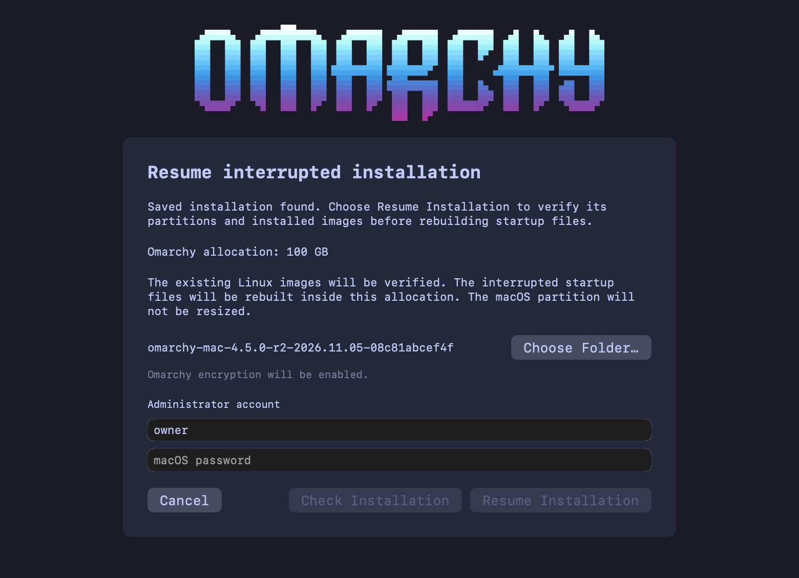

# Resuming the native Recovery staging failure

This recovery flow handles the released installer engine `v0.9.2-omarchy.20261022.31425f17fb9b` stopping after `stub_and_esp_started`, with an `apfs-target-prepared` checkpoint and no completed boot-file checkpoint. This is the state left by the AppleDouble failure in issues #176, #177 and #180. Normal installation retry remains fail-closed.

## In the app

Use an updated app **and its matching helper**, with the resume-capable engine bundled in the app. An engine-only catalog update cannot add the UI or helper operation to installer 2.3.15.

1. On startup, the app keeps a neutral checking view visible until inspection finishes. If the matching installed helper finds an incomplete supported journal, the dedicated resume page opens automatically. It replaces the main window content rather than appearing as a sheet over an older screen. The app never installs or replaces the helper during startup inspection. With an older or unavailable helper, choose **Installation → Resume Interrupted Installation…** and authorize the matching helper first. The menu action also remains available after a failed execution while no other operation runs.
2. Enter your macOS administrator account and password, then choose **Check Installation**. The app ensures the matching helper is installed. The helper finds the original protected journal and issues a short-lived approval for that record.
3. Keep or choose the original download folder containing `installer_data.json` and the original `*-os-package.zip`. The app suggests a cached folder. The helper accepts its contents only when their hashes match the original journal. A newer release's files cannot substitute for the original download.
4. The update channel follows the app's selected release channel. The original payload remains fixed by its saved hash. Public builds retain their encryption policy; this flow adds no plaintext-install option.
5. Choose **Resume Installation**. Full image readback and stub reconstruction can take several minutes. Keep the Mac open and connected to power.
6. Follow the Recovery instructions shown only after engine completion, install-configuration readback and EFI unmount are confirmed.

If a request loses its reply or final configuration cannot be confirmed, stay in macOS and use **Check Installation** again. A completed recovery journal is rediscovered and revalidated; completed reconstruction is not repeated. Preserve the journal and its evidence files.

Completed engine records are not automatically reopened on startup. They remain available through the explicit Resume action for final-handoff retry. Canceling the resume page suppresses automatic reopening for the rest of that app launch.

The screenshot is rendered from the real SwiftUI page with test data. It shows the resume UI, not a completed Recovery boot.

## Authority and verification

The existing root-owned journal is the authority for the original allocation, model, metadata and payload hashes. The new signed helper owns discovery and the approval ticket. The client supplies file descriptors, never a journal path, disk identifier or replacement plan. Both discovery and execution use the helper's existing work lock, including final configuration publication.

The helper takes private snapshots of the selected files and verifies their hashes. It obtains the recovery engine from the authenticated calling app and checks it against the helper's compiled engine pin. The original plan and its digest remain unchanged. The recovery binding separately records the replacement engine digest.

Before reconstruction, the engine verifies:

- the original prepared APFS partition UUID, size and offset;
- exactly one EFI and two Linux partitions in the approved extent, with the expected types, sizes and ordering;
- the stub's original boot object, including its binding to this EFI partition;
- the complete installed boot/root image prefixes against the authenticated ZIP members;
- the installed board-specific EFI payload tree and native Recovery input.

It then records the verified partition identities and image hashes in `interrupted-stub-and-esp-bound`, and synchronizes the evidence directory before reconstruction. A second attempt uses that binding if the first attempt interrupted reconstruction. A changed target or different replacement engine is rejected before reconstruction.

## Mutation boundary

Resume rebuilds files inside the existing APFS stub volumes and finishes native Recovery staging. It preserves the partition table and Linux boot/root image contents. It does not run the normal resize, partition-creation or raw-image-write methods.

Before invoking upstream stub writers, the engine verifies each target mount's volume UUID, holds its root descriptor and temporarily seals the root against other users. Existing write trees must be owned by the privileged installer, deny group/other writes and contain no ACL grants, foreign mounts, hard links or unexpected symlinks. The exact System-to-Preboot Restore link and the three standard links inside BootabilityBrain.framework are allowed only at their specific paths with their expected targets. This boundary stays in force through Recovery authorization. Original root modes are restored on exit.

The three local qualification engines (`sha256:f314b55eeb6268cc92503ea5f5cec799035b0ecb6b78b83bfaa5c3c319ac985d`, `sha256:559c2bb177f062baa0d0a4830ab611ab272f2ec90c7e4d0589fba09fdb55b32f`, and `sha256:2e3a5a138c25912ec7301a0380614371f96f2f8a70b48fdd3ff0bf8f899c0b68`) and the reviewed PR engine before the upstream rebase (`sha256:ca2484488365ad34abacfead5400e959b6f5f88ffba011a97ea278693bef77e8`) can migrate their saved bindings. Every target, owner, geometry and image field must match a fresh verification; only the replacement engine digest may change. New rebound checkpoints include their evidence hash in their identifier and preserve the original binding and all earlier rebound evidence. The two earlier fixed rebound identifiers remain readable. Arbitrary previous engine digests are refused.

Before regenerating Apple's BaseSystem image, resume unlinks that exact file within the protected Recovery tree. Opening an existing decmpfs-compressed image for writing can otherwise require space to expand the old image before truncation, exhausting the small shared APFS stub. A disposable APFS image reproduced the failure and verified that unlinking before regeneration avoids it.

The existing EFI tree has already been filtered for this board and is fully read back before reconstruction. Resume does not rerun first-install board filtering, whose source files for other boards have already been removed or renamed. Its private Recovery snapshot still uses the appropriate authenticated Stage 2 payload member for this board.

Firmware is regenerated. The Recovery app, Stage 2 and firmware inputs are staged from private verified copies. Mutable files on EFI cannot replace those inputs. An optional firmware file that was not regenerated is removed from the EFI target.

Only after staging and installed-content verification does the engine publish `stub-and-esp-installed` and enter the normal Recovery handoff. The helper then writes and verifies `omarchy/install.conf` and confirms EFI unmount before reporting success.

The resumed installer log records **Verified existing partitions**, with all four UUIDs and types. Removal recognizes that explicit receipt alongside the existing stub/EFI boot-chain evidence. The log does not claim that resume created new partitions.

## Refusals and validation limits

The flow refuses unsupported engines, ambiguous journals, missing or changed evidence, changed payloads, changed partitions, modified Linux images and unsafe stub trees. A first recovery attempt also refuses pre-existing native Recovery staging: that is a later interruption requiring separate reconciliation, rather than the pre-staging AppleDouble boundary this flow handles.

Local source tests cover interruption/replay, input and partition substitutions, external-file redirection, access controls, metadata handling, truthful removal receipts, helper admission and UI layout. macOS debug/release tests and engine reproduction provide source/build evidence. A physical installation/resume remains a separate qualification step; source tests do not establish successful boot or enrollment on hardware.
